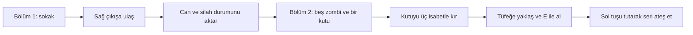

# Çernobil — Son Tahliye

> Bu depo mevcut proje kaynaklarının 50 konu başlığıyla ilk kez Git içine alınmış kopyasıdır. Commitler paket hazırlanırken gerçek güncel tarihle oluşturuldu; 28–31 Ekim çizelgesi önerilen iş planıdır, geçmişe ait düzenli commit geçmişi iddiası değildir. Güncel başlangıç sahnesi `13_FinalBolum1`, ikinci bölüm `14_FinalBolum2`, final `15_SonTahliye`dir. Eski adım açıklamaları geliştirme notlarıdır.

Unity 6 (6000.0.32f1), C#, üstten görünümlü 2D macera oyunu.

## Adım 1: hareket denemesi

1. Unity Hub → Projects → Add → Add project from disk yolundan bu klasörü seç.
2. Unity 6000.0.32f1 ile aç ve ilk içe aktarmanın bitmesini bekle.
3. Üst menüden `Cernobil → Adim 1 - Deneme Sahnesini Olustur` seç. Bu işlem `Assets/Scenes/01_HareketDenemesi.unity` sahnesini oluşturup açar.
4. Üstteki Play düğmesine bas, ardından Game alanına tıkla.
5. WASD veya yön tuşlarıyla karakteri hareket ettir.
6. Beton bariyerlere yürüyerek içlerinden geçemediğini kontrol et.
7. Çapraz giderken hızın artmadığını ve kameranın takip ettiğini kontrol et.
8. Play düğmesine tekrar basarak denemeyi bitir.

Sonraki açılışlarda sahneyi doğrudan Project bölümünden açabilirsin.
Sahne oluşturma komutu mevcut deneme sahnesini yeniden oluşturur; elle yaptığın değişikliklerin üzerine yazabilir.

Otomatik editör doğrulaması Unity lisans bileşeninin bilgisayar bilgilerine erişim hatası nedeniyle tamamlanamadı.
Derleme ve oynanış kontrolü henüz doğrulanmış değildir. Hub bir lisans uyarısı gösterirse hesabındaki uygun Unity lisansını etkinleştir.

Bu aşamanın görselleri geçicidir. Konsept çizimlerindeki detaylı sanat henüz uygulanmadı.
Zombi, NavMesh yardımcısı ve Ollama diyaloğu sonraki aşamalarda geliştirilecek.
Bu sürüm ödevin tamamlanmış teslimi değildir.

## Adım 2: nişan alma ve atış

Önce Play modunu durdur ve Unity'nin yeni kodları yüklemesini bekle.
`Cernobil → Adim 2 - Atis Sahnesini Olustur` seç. İlk sahnenin kopyasından ayrı
`02_AtisDenemesi.unity` sahnesi oluşturulur. Adım 2 komutunu tekrar kullanmak bu deneme kopyasını sıfırlar.

- Fare: tabancayı yönlendirir. Sol tık: tek atış. WASD: hareket.
- Şarjör 12 mermi tutar. R: 1,2 saniyede doldurur. Bu denemede yedek mermi sınırsızdır.
- Turuncu hedefler üç isabette yok olur; hasarla renkleri koyulaşır.
- Bariyerler atışı keser. Sağdaki hedefe duvar arkasından ateş ederek bunu kontrol et;
  sonra bariyerin çevresinden dolaşıp doğrudan ateş et.
- Şarjör boşken ateş edilemediğini, dolum sırasında ateş edilemediğini,
  hedefin üçüncü isabette kaybolduğunu dene.
- Hedefleri geri getirmek için Play modundan çıkıp tekrar gir.
- Game ekranı kesiliyorsa üstteki Scale değerini 1x veya daha aşağı indir.

Adım 1 hareketi kullanıcı tarafından doğrulandı. Adım 2 oyun ve editör kodları Unity'nin
C# derleyicisi ve proje referanslarıyla hatasız derlendi. Adım 2'nin oynanış kontrolü henüz yapılmadı.

## Adım 3: yavaş yaklaşan zombiler

Play modunu durdur. Kodlar yüklendikten sonra `Cernobil → Adim 3 - Yavas Zombileri Olustur` seç.
Atış sahnesinden ayrı `03_ZombiDenemesi.unity` oluşturulur. Play'e basıp Game alanına tıkla.

- Üç hedef, oyuncuyu saniyede 1,1 birim hızla takip eden yeşil zombilere dönüşür.
- Oyuncunun hareket hızı saniyede 4 birimdir; zombilerden yürüyerek uzaklaşabilirsin.
- Zombiler oyuncuya yaklaşık 1 birim kalınca durur. Bu aşamada oyuncuya hasar vermezler.
- Üç isabet alan zombi yok olur. WASD, sol tık ve R aynı şekilde çalışır.
- Bu ilk davranış doğrudan takip ve fiziksel çarpışmadır. Zombiler engelleri dolaşacak bir rota
  hesaplamaz; bariyere takılabilirler. Projenin zorunlu NavMesh yardımcısının yerine geçmez.
- Kontrol: yerinde bekleyince yaklaşmaları, uzaklaşınca tekrar takip etmeleri, üç isabette yok
  olmaları ve beton engellerin içinden geçmemeleri. Play'i yeniden başlatınca zombiler geri gelir.
- Adım 3 menüsü her kullanıldığında üçüncü deneme sahnesini yeniden oluşturur.

## Adım 4: saldırı, oyuncu canı ve yeniden başlama

Play modunu durdur. `Cernobil → Adim 4 - Saldiri ve Can Sahnesini Olustur` seç.
`04_HayattaKalma.unity` ayrı oluşturulur; Play'e basıp Game alanına tıkla.

- Oyuncu 100 can ile başlar. Sağ üstte can göstergesi bulunur.
- Zombiler 1,2 birim mesafeden, 1,3 saniyelik saldırı aralığıyla 10 hasar verir.
- Duvarlar yakın mesafe saldırılarını da engeller. Zombiler hâlâ engelleri dolaşacak rota hesaplamaz.
- Hasar sonrası 0,6 saniye koruma, aynı anda gelen darbelerin canı bir karede tüketmesini önler.
- Hasar alınca ekran kısa süre kırmızı yanar. Sıfır canda hareket, ateş ve zombilerin takibi/saldırıları durur.
- Yeniden Başla düğmesi veya Enter, sahneyi tam can, dolu şarjör ve tüm zombilerle yeniden açar.
- Denemeler: uzaktayken canın değişmemesi; yaklaşan zombinin 10 hasar vermesi; kaçarak saldırıdan
  uzaklaşılması; duvar arkasından hasar alınmaması; sıfır canda hareket/ateşin durması; düğmeyle ve
  Enter ile yeniden başladıktan sonra canın 100, merminin 12, zombilerin üç olması.
- Adım 4 menüsünü tekrar kullanmak dördüncü deneme sahnesini yeniden oluşturur.

Doğrulama: Adım 2 ve 3 oynanışı kullanıcı tarafından doğrulandı. Adım 4 oyun ve editör kodları,
Unity'nin C# derleyicisi ve projenin referanslarıyla hatasız derlendi. Adım 4 için yukarıdaki
oynanış kontrolleri henüz yapılmadı.

## Adım 5: ilk piksel sokak

Play'i durdur, görsellerin ve kodların yüklenmesini bekle.
`Cernobil → Adim 5 - Piksel Sokagi Olustur` seç.
Bu komut Adım 4'ten ayrı `05_PikselSokak.unity` sahnesini oluşturur.
Play'e basıp Game alanına tıkla. Game ekranını 16:9 oranında ve Scale 1x veya altında kullan.

- Çatlak asfalt, kaldırım, terk edilmiş bina cephesi, paslı araç ve çitli sokak arka planı.
- Oyuncu ve zombiler artık ayrı şeffaf piksel karakter görselleri kullanır.
- Oyuncu fare yönüne, zombiler hareket yönüne göre sağa/sola döner. Yürürken hafif salınım uygulanır.
  Bunlar henüz dört yöne çizilmiş kare kare yürüme animasyonları değildir.
- Hareket, nişan, şarjör, üç isabette zombi ölümü, saldırı, oyuncu canı ve yeniden başlama korunur.
- Bina cephesi, araç ve alt çit için çarpışma sınırları eklenir; eski deneme bariyerleri kaldırılır.
- Zombilerin doğrudan takibi devam eder; engel çevresinden rota bulma bu aşamada eklenmedi.
- Önceki dört sahne korunur. Adım 5 menüsünü tekrar kullanmak beşinci deneme sahnesini sıfırlar.
- Kontrol: karakterlerin beyaz/siyah kutu olmadan görünmesi, fare yönüne dönmesi, zombilerin
  takip etmesi, ateşle hasar almaları, oyuncunun can kaybetmesi ve yeniden başlamanın çalışması.

Görseller `Assets/Art/Street/` altındadır. Üretim istemleri `Art-Prompts.md` içindedir.
Bu görünüm ilk konseptin tarzını hedefleyen başlangıç sokağıdır; robot ve görev NPC'si henüz eklenmedi.
Adım 5 oyun ve editör kodları Unity C# derleyicisiyle hatasız derlendi; oyun içi kontrol henüz yapılmadı.

## Adım 6: büyük karakterler, koşma ve elde tabanca

Play'i durdur. İçe aktarma bitince `Cernobil → Adim 6 - Buyuk Karakter Kosu ve Silah` seç.
`06_KosuVeSilah.unity` ayrı oluşturulur. Önceki beş sahne korunur.

- Oyuncunun görseli 1,8 kat, zombiler 1,7 kat büyür; kamera da biraz yakınlaşır.
- WASD yürütür. Shift + WASD, hızı 4'ten 6,4 birim/saniyeye çıkarır. Çapraz yönün hızı sınırlandırılır.
- Oyuncunun dört çizilmiş hareket karesi sırayla oynatılır. Koşarken kareler daha hızlı değişir;
  durunca sabit duruş karesine dönülür. Bu sürüm sağ/sol görünüş kullanır; dört yön çizimi henüz yoktur.
- Ayrı piksel tabanca sprite'ı el hizasına bağlanır. Fare yönünde döner; sol tarafa dönerken ters duran
  kabza düzeltilir. Atış çizgisi namludan başlar, kısa süreli namlu parlaması görünür.
- Büyüyen karakterlerin çarpışma alanları ve zombi saldırı mesafeleri birlikte ayarlanır.
- Oyuncu ile namlu arasında duvar varsa atış duvardan geçmez.
- Can, hasar, şarjör ve yeniden başlama korunur.

Kontrol: karakterin büyümesi, hareket edince bacak karelerinin değişmesi, Shift ile hızlanma,
durunca animasyonun durması, sağ/sol tabanca yönü, namlu parlaması, hedefe isabet,
duvarın atışı kesmesi ve ölümden sonra yeniden başlama.

Oyun ve editör kodları Unity'nin derleyicisiyle hatasız derlendi. Dört karenin birbirinden farklı
olduğu, karakter ve tabanca dosyalarının alfa kanalı taşıdığı kontrol edildi. Oyun içi kontrol henüz yapılmadı.
Yeni görseller `Assets/Art/Street/SurvivorRun.png` ve `Pistol.png`; üretim istemleri `Art-Prompts-Step6.md`.

## Adım 7: ikinci bölüm, kırılabilir kutu ve otomatik tüfek

Play'i durdur, kod ve görsellerin içe aktarılması bitince
`Cernobil → Adim 7 - Iki Bolum Kutu ve Tufek` seç.
Komut iki yeni sahneyi kaydeder, ikisini de Build Settings'e ekler ve ilk bölümü açar:

- `07_Bolum1.unity`: Üç zombili ilk sokak. En sağdaki yeşil işaretli çizgiye ilerleyince ikinci bölüm yüklenir.
- `08_Bolum2.unity`: Yeni depo sokağı. Oyuncu solda, beş zombi ve bir kapalı kutu ile başlar.

Kutuyu üç kez vur. Kutu yok olunca yerinde bir tüfek belirir. Yaklaşıp E'ye bas;
eldeki tabanca yerini otomatik tüfeğe bırakır. Tüfeği almak isteğe bağlıdır.

| Özellik | Tabanca | Otomatik tüfek |
| --- | --- | --- |
| Şarjör | 12 | 24 |
| Atış aralığı | 0,20 saniye | 0,09 saniye |
| Ateş girdisi | Her atış için sol tık | Sol tuş basılı tutulur |
| Doldurma süresi | 1,2 saniye | 1,6 saniye |
| İsabet hasarı | 1 | 1 |

İkinci bölüme geçerken can, silah türü ve mevcut mermi sayısı korunur.
Ölümden sonra yeniden başlama bulunduğun bölümü tam can, dolu tabanca şarjörü ve ilk yerleşimiyle sıfırlar;
ikinci bölümde kutu ve beş zombi tekrar gelir. Tüfeği yeniden almak gerekir.
Beş zombi de öldüğünde görev yazısı bölgenin temizlendiğini bildirir; ikinci bölüm keşfe açık kalır.
Bu aşamada üçüncü bölüme geçiş eklenmedi.

Doğrulama: Oyun ve editör kodları Unity C# derleyicisiyle hatasız derlendi.
Gerçek `LevelTransfer` koduyla yedi otomatik kontrol geçti: boş başlangıç, can/tabanca/mermi aktarımı,
tek seferlik tüketim, tüfek ve boş şarjörün korunması, yanlış sahneye aktarımın reddi,
eski aktarımın temizlenmesi ve yeniden başlama temizliği.
Kutu/tüfek görsellerinin alfa kanalları kontrol edildi. Kurulum beş zombi sayısını ayrıca denetler.
Sahnelerin Unity içinde oluşturulması ve oynanışın uçtan uca kontrolü henüz yapılmadı.

Manuel kontrol: İlk bölümde can ve mermi değerlerini not edip sağ çıkıştan geç; değerlerin aynı kaldığını gör.
İkinci bölümde beş zombiyi, tek kutuyu, üçüncü isabette düşen tüfeği, E ile silah değişimini,
basılı ateşi, 24 mermiden sonra boş şarjörü, R ile doldurmayı ve ölümden sonra sahnenin sıfırlanmasını dene.
Adım 7 menüsünü tekrar kullanmak bu iki bölüm kopyasını yeniden oluşturur; önceki deneme sahneleri korunur.

Yeni görseller `Assets/Art/Street/DepotStreet.png`, `SupplyCrate.png`, `Rifle.png`;
silah ayarları `Assets/Data/Weapons/`; üretim istemleri `Art-Prompts-Step7.md`.

## Adım 8: zorunlu otonom yardımcı ve santral kapısı

`09_RobotBolum1.unity` ve `10_RobotBolum2.unity` sahneleri oluşturuldu.
İlk robot bölümünü açıp Play'e bas. Sağ çıkış seni robotlu ikinci bölüme götürür.
Gerekirse `Cernobil → Adim 8 - Yardimci Robot ve Santral Kapisi` sahneleri yeniden kurar;
bu menü iki robot sahnesindeki elle yapılmış değişikliklerin üzerine yazar. Önceki sahneler korunur.

1. İkinci bölümde mevcut beş zombi ve kutu/tüfek sistemi devam eder.
2. Sağdaki santral kapısına, sarı zemin işaretine ilerle.
3. Robot yakına geldiğinde ekranda E ile emir verme yazısı çıkar.
4. E'ye basınca robot üstteki dar servis geçidinden kontrol paneline gider.
5. Paneli çalıştırır; kapı yukarı kayarak açılır. Oyuncu açılan alandan geçebilir.
6. Robot oyuncuya döner ve takip etmeye devam eder.

Robot yolunu gerçek Unity NavMeshBuilder ve NavMeshAgent ile hesaplar. Üç Raycast çevreyi algılar.
Servis aralığı oyuncunun çarpışma alanından dardır; oyuncu kapıyı kendi başına veya ateş ederek açamaz.
Camgöbeği görev çizgisi hazır çizilmiş bir yol değildir; NavMeshAgent'ın gerçek rota köşeleridir.
NavMesh, kapı/kutu engelleri değişince güncellenir. Robot kodu yerel LLM bileşeninden bağımsızdır.

Kurulum sırasında 13 gerçek Unity NavMesh/Physics2D kontrolü geçti; dört farklı başlangıçtan tam servis
yolu bulundu. Ölçümler `NavMesh-Test-Sonuclari.json` içindedir. NavMesh ilk oluşturma ölçümü yaklaşık 8,67 ms idi;
bu yalnızca bu makinedeki tek ölçümdür. Canlı ilk deneme panel ve kapı açılmasını doğruladı; kapı açıldıktan
sonraki dönüşte SetPath ataması reddedildi. Son kod bunu SetDestination ile yeniden hedefleyerek düzeltti.
Canlı görevin tamamı için son durum `Robot-Canli-Test-Sonuclari.json` dosyasından takip edilmelidir;
başarı oranı yalnızca başarılı canlı ölçümlerden yazılmalıdır.

Detaylı mimari, durum diyagramı ve yeniden test menüleri `Robot-Tasarimi.md` içindedir.
Yeni görseller `Assets/Art/Companion/` altında, üretim istemleri `Art-Prompts-Step8.md` içindedir.
Game ekranında kenarlar kesiliyorsa Scale değerini 1x veya aşağısına indir.

## Modern oyun arayüzü

Mevcut sahneler otomatik güncellenir; yeniden sahne oluşturma menüsü gerekmez.
Unity kodları yükledikten sonra Play'e bas.

- Sol üst: küçük oyun başlığı, bölüm adı ve görev kartı.
- Sol alt: sayısal can, yumuşak güncellenen can barı; yarı canda amber, kritik canda kırmızı uyarı.
- Sağ alt: aktif silah adı ve görseli, büyük kalan mermi sayısı, şarjör kapasitesi ve R ipucu.
- Doldururken mermi çubuğu dolum ilerlemesini gösterir; az/boş mermi renkli bildirilir.
- Sağ üst: canlı kalan zombi sayısı.
- Alt orta: robot durumu ve gerektiğinde E ile etkileşim kartı; küçük kontrol tuşları.
- Bölüm yükleme ve ölüm/yeniden başlama ekranları aynı görsel dili kullanır.

Arayüz çözünürlük oranına göre ölçeklenir. Unity Game önizlemesi yakınlaştırılmışsa Scale sürgüsünü
sola çekerek oyun görüntüsünü ekrana sığdır. Yeni arayüz ayrı paket, model veya internet istemez.
Eski can/robot/etkileşim kutuları tek çizim düzeninde birleştirildi. Kodlar Unity C# derleyicisiyle
hatasız derlendi. Oyun içi görsel doğrulama bu değişiklik için henüz tamamlanmadı.

## Kodun görevleri

- `IMovementInput`: Hareket girdisinin sözleşmesi.
- `KeyboardMovementInput`: Klavyeden yönü okur; çapraz yönün hızını sınırlar.
- `PlayerMovement`: Rigidbody2D üzerinden hareketi uygular.
- `CameraFollow`: Kamerayı karakterin yakınında tutar.
- `PrototypeOverlay`: Deneme sırasında kontrol bilgisini gösterir.
- `FirstStepSetup`: Yalnızca editörde başlangıç sahnesini oluşturur ve yapılandırmasını denetler.
- `Health` / `IDamageable`: Hasar alma ve canın bitmesi.
- `PlayerWeapon`: Nişan, atış, duvarda durma ve şarjör işlemleri.
- `TargetFeedback`: Hasarı hedefin rengine yansıtır.
- `SecondStepSetup`: İlk sahneden bağımsız atış denemesi kopyasını kurar.
- `ZombieChase`: Yavaş yaklaşma ve yakında durma.
- `ThirdStepSetup`: Üç hareketli zombinin bulunduğu ayrı deneme sahnesini kurar.
- `ZombieAttack`: Mesafe, görüş hattı ve bekleme süresine göre yakın saldırı yapar.
- `PlayerLife`: Ölüm olayında oyuncunun kontrolünü durdurur.
- `SurvivalSession`: Can göstergesi, hasar bildirimi, ölüm ekranı ve yeniden başlama.
- `FourthStepSetup`: Saldırı ve can denemesini ayrı sahnede kurar.
- `PixelActorPresentation`: Görselin yönünü, yürüyüş salınımını ve çizim sırasını yönetir.
- `FifthStepSetup`: Piksel görselleri içe aktarır, sokak görünümünü ve çevre çarpışmalarını kurar.
- `SixthStepSetup`: Karakter boyutu, koşu kareleri, kamera ve elde silah bağlantısını ayrı sahnede kurar.
- `WeaponDefinition`: Silahın görselini, şarjörünü, doldurma ve atış hızını ayrı veri olarak tutar.
- `StageProgression` / `LevelExit`: Sağ çıkıştan sonraki sahneyi yükler, görev bilgisini sağlar.
- `LevelTransfer`: Sahneye özel can/silah/mermi durumunu yalnızca bir kez aktarır.
- `WeaponCrate`: Kutunun ölümüyle ayrı tüfek nesnesini görünür yapar.
- `WeaponPickup`: Oyuncunun E ile tüfeği almasını ve kuşanmasını sağlar.
- `SeventhStepSetup`: İki sahneyi, beş zombiyi, kutuyu ve silah verilerini oluşturur.
- `CompanionNavigationWorld`: Fiziksel engellerden gerçek NavMesh oluşturur ve günceller.
- `CompanionRobot`: Takip, emir, panele gitme, etkileşim, dönüş ve hata durumlarını yönetir.
- `RobotObstacleSensor`: Raycast ile engel uzaklığı ve açısını ölçer.
- `SantralGate` / `GateControlPanel`: Panel yetkisini, kapının kilidini ve açılmasını yönetir.
- `CompanionNavMeshValidation` / `CompanionPlayValidation`: Yerel yol ve gerçek oynatma testlerini ölçer.

## Geliştirme sırası

Baştan oynama, net yazılar ve boş panel temizliği için [Arayuz-ve-Yeniden-Oynama.md](Arayuz-ve-Yeniden-Oynama.md). Bitiş ekranı ilk bölüme döner; ölüm ekranı mevcut bölümü yeniden dener.

Üç bölümlü final sürümü: **13_FinalBolum1 → 14_FinalBolum2 → 15_SonTahliye**. İkinci bölümde robot kapısından sonra sağ çıkış; üçüncü bölümde serbest metinle sığınak görevlisinden izin ve kapıdan tahliye. Kullanım ve test kapsamı: [Siginak-Finali.md](Siginak-Finali.md).

Yerel NPC altyapısı eklendi. Kurulum, Adım 9 sahneleri, kullanım, ölçülen kontroller ve henüz yapılmamış canlı testler için [Yerel-NPC-Kurulum.md](Yerel-NPC-Kurulum.md) dosyasına bak. Sunucu yalnız bilgisayarın kendi Ollama adresidir; ilk model indirmesinden sonra internet gerekmez.

1. Hareket, kamera, çarpışma.
2. Nişan alma, ateş etme, can sistemi.
3. Zombi durumları ve bölüm ayarları.
4. Gerçek NavMesh yol bulmalı yardımcı, sensör ve kapı bulmacası.
5. Yerel Ollama NPC, JSON doğrulama ve hata yönetimi.
6. Bölüm akışı, sanat, ölçümlü testler ve build.

## Rapor için tamamlanacaklar

Ekip üyeleri, model seçimi, durum ve sıra diyagramları, gerçek ekran görüntüleri,
ajan başarı oranı ve süre ölçümleri, en az beş gerçek NPC diyalog testi,
hata senaryoları ve sınırlılıklar eklenecek. Ölçülmemiş sonuçlar yazılmamalı.
Her iki ekip üyesi geliştirme boyunca düzenli ve dengeli commit yapmalı.
