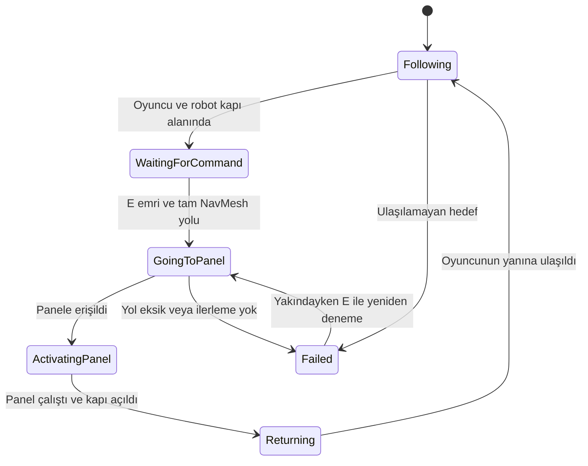

# Otonom yardımcı robot

## Oyuncunun akışı

İkinci bölümde robot oyuncuya eşlik eder. Sağ taraftaki santral kapısı kilitlidir ve ateşle hasar almaz.
Oyuncu kapı önündeki sarı işarete yaklaşır. Robot da yakındayken E ile kapıyı açma emri verilir.
Robot, üst taraftaki dar servis geçidinden panele ulaşır, paneli çalıştırır ve açılan kapıdan oyuncuya döner.
Kutu ve tüfek etkileşimi kapı emrinin alanından uzaktır; ikisi aynı E basışında tetiklenmez.

## Gerçek NavMesh uygulaması

`CompanionNavigationWorld`, Unity'nin `NavMeshBuilder.BuildNavMeshData` API'siyle yürünebilir zemin ve
`NavigationObstacle2D` ile işaretli fiziksel engellerden gerçek NavMesh verisi üretir.
Hareketi `NavMeshAgent` gerçekleştirir. `CompanionRobot` yalnızca nihai hedefi seçer;
elle sıralanmış ara hedefler veya robotu hedefe taşıyan `MoveTowards` kullanılmaz.

Oyun XY düzlemindedir. Unity'nin XZ düzlemindeki yerel NavMesh sistemi ayrı bir mantıksal düzlemde
kullanılır: `(oyun.x, oyun.y)` ↔ `(nav.x, -50, nav.z)`. NavMeshAgent'ın hesapladığı gerçek konum
görsel robota yansıtılır. Bu bir koordinat uyarlamasıdır; yol hesabını ve ilerlemeyi NavMeshAgent yapar.
Ek 2D NavMesh eklentisi veya bulut servisi gerekmez; Unity'nin yerleşik AI modülü kullanılır.

Robot yarıçapı 0,2 birim, servis geçidinin genişliği 1,0 birimdir. Oyuncunun çarpışma yüksekliği
1,4 birim olduğundan oyuncu geçide sığmaz. Robotun NavMesh alanı bu geçitte süreklidir.
Kapı açılınca fiziksel engeli kaldırılır ve `UpdateNavMeshDataAsync` ile navigasyon verisi güncellenir.
Yok edilen kutu gibi statik engel değişiklikleri de yeniden hesaplamaya alınır.

## Sensörler ve karar durumu

`RobotObstacleSensor`, hareket yönünde ve ±30 derecede üç gerçek Physics2D Raycast kullanır.
Engel uzaklığı ve göreli açısı okunabilir özelliklerde tutulur. Çok yakın engelde robot durur,
NavMesh güncellenir; yol bulunamıyorsa görünür hata ve yeniden E ile deneme sağlanır.
Oyuncu öldüğünde robot da durur.

Panel yalnızca kendisine atanmış robotu ve yakın mesafeyi doğrulayarak kapıyı açar.
Oyuncuya kapı açan bir etkileşim verilmez. Robotun görevdeki camgöbeği rota çizgisi,
NavMeshAgent'ın o anda hesapladığı `path.corners` verisinden çizilir.

## Tekrarlanabilir doğrulama

`Cernobil → Robot - NavMesh Yol Testlerini Calistir`, ikinci robot sahnesinde 13 yerel Unity kontrolü çalıştırır.
Dört başlangıçtan tam yolları ve servis geçidinden geçişi; kapalı kapının doğrudan yolu engellemesini;
oyuncunun geçide sığmamasını; robotun sığmasını; Raycast mesafesini; yetkisiz panel erişiminin reddini;
açılan kapının NavMesh güncellemesini ve daha kısa dönüş yolunu kontrol eder.
Sonuçlar `NavMesh-Test-Sonuclari.json` dosyasına yazılır. Bu kontroller gerçek Unity editöründe çalıştırıldı ve geçti.

`Cernobil → Robot - Canli Gorev Testlerini Calistir`, oynatma modunda dört farklı başlangıçla
robotun gerçekten yürümesini, servis geçidinden geçmesini, paneli çalıştırmasını, kapıyı açmasını
ve oyuncuya dönmesini sınar. Çatışma bileşenleri yalnızca test sırasında kapatılır; testler sahne varlıklarını
değiştirmez. Başlangıç konumu her testin başında kurulur; emirden sonraki hareket NavMeshAgent'a aittir.
Ölçümler `Robot-Canli-Test-Sonuclari.json` içine yazılır. Ölçülen süreler rapora buradan alınmalıdır.

## Sınırlar

Bu aşama fiziksel engel ve yardımcı ajan gereksinimini hedefler. Yerel LLM NPC diyaloğu henüz eklenmedi.
Robot dost karakterdir; zombilerin saldırı hedefi oyuncudur. Dinamik zombiler NavMesh bake engeli olarak
kullanılmaz; statik duvarlar, kapı, kontrol paneli tabanı ve kutu navigasyon geometrisidir.

## Unity kaynakları

- https://docs.unity3d.com/6000.0/Documentation/ScriptReference/AI.NavMeshBuilder.BuildNavMeshData.html
- https://docs.unity3d.com/6000.0/Documentation/ScriptReference/AI.NavMeshAgent.html
- https://docs.unity3d.com/6000.0/Documentation/ScriptReference/AI.NavMeshBuilder.UpdateNavMeshDataAsync.html
